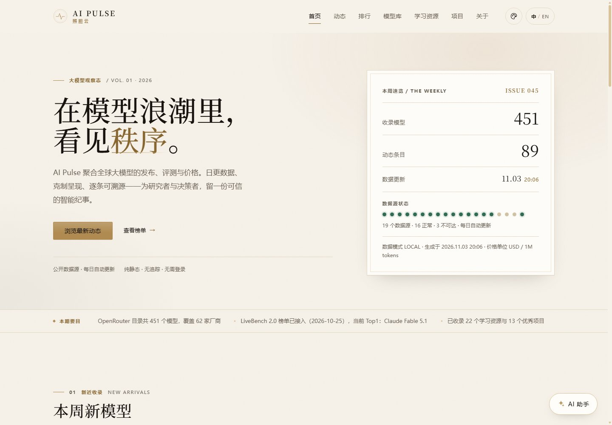
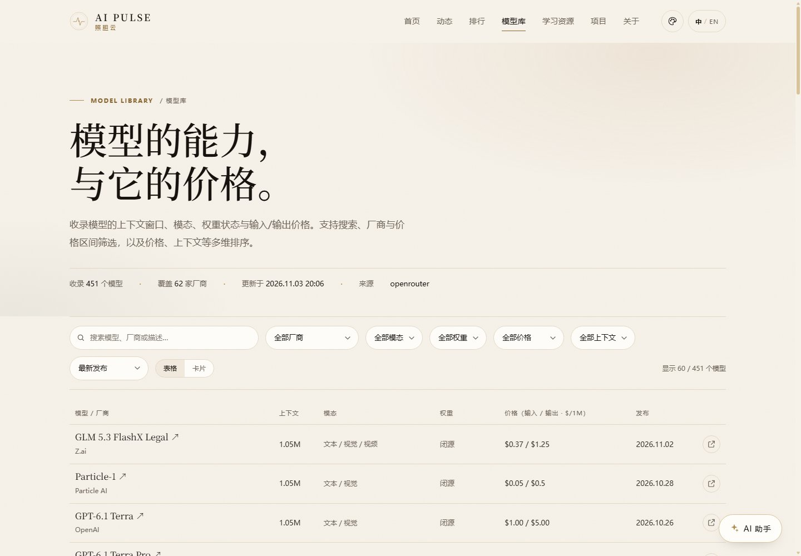
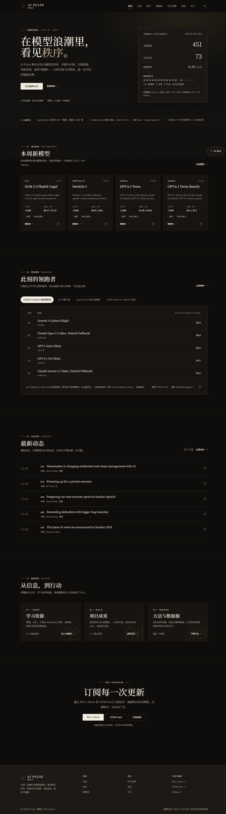
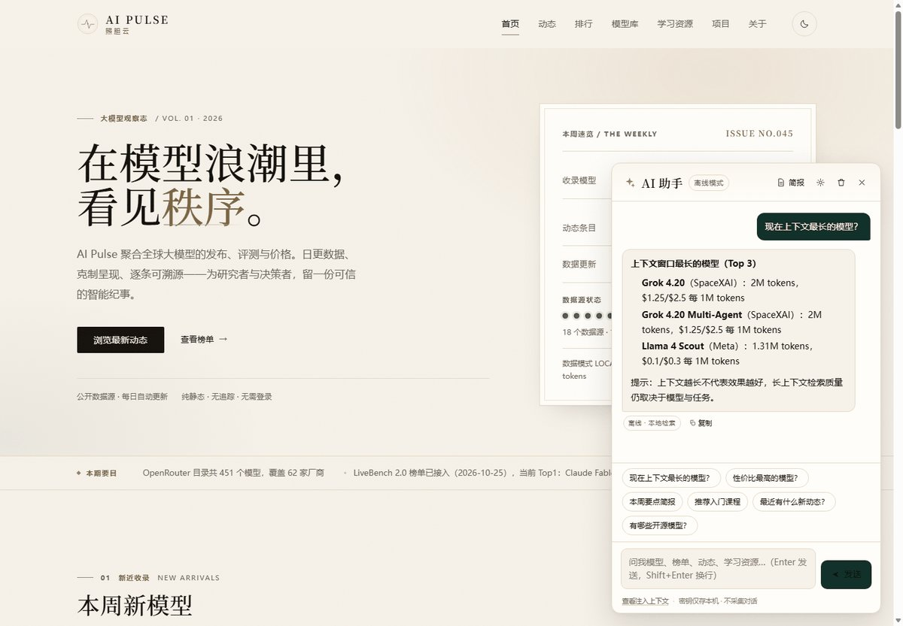
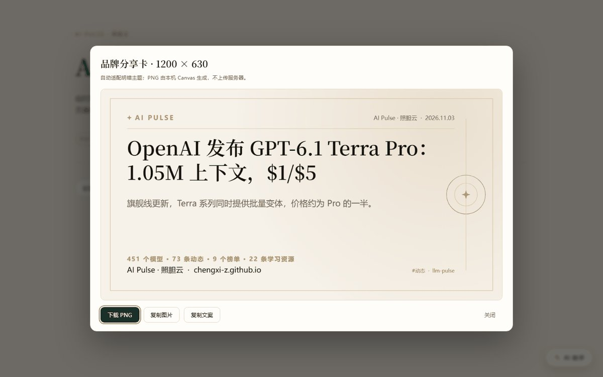

# AI Pulse

**English** | [中文](README.md)

> An open, lightweight, quietly luxurious LLM observatory: **model updates / leaderboards /
> model catalog / learning resources / projects**, with a BYOK AI assistant, refreshed daily.

[](https://github.com/chengxi-Z/llm-pulse/actions/workflows/ci.yml)
[](https://github.com/chengxi-Z/llm-pulse/actions/workflows/deploy.yml)
[](LICENSE)
[](https://chengxi-z.github.io/llm-pulse/)

**Live site**: <https://chengxi-z.github.io/llm-pulse/>　**Data refreshed daily** (GitHub Actions).

> **v1.1.1 is live** (2026-11) — five themes, English UI, engineering English, and the
> one-sentence-project Skill. **v1.2 in progress**: overview dashboard, My Skills library, and
> distribution enhancements. See [acceptance report](docs/ACCEPTANCE.md),
> [release notes](docs/RELEASE.md), [spec](docs/SPEC.md), [data contract](docs/DATA-CONTRACT.md),
> [POC report](docs/POC-REPORT.md), [AI/share design](docs/AI-SHARE.md),
> [v1.2 contract](docs/V1.2-CONTRACT.md), and [English style guide](docs/EN-STYLE.md).

---

## What is this

The LLM space moves fast: new models, new prices, new leaderboards and new tools appear almost
every day, but the information is scattered across vendor sites, Twitter/X, leaderboard pages and
papers. **AI Pulse** aggregates public information into one readable "chronicle of intelligence":

- **Updates**: model releases, version iterations, pricing and evaluation changes, on a timeline,
  each entry with its source; v1.3 adds topic deep links (`news.html?tag=<topic>`) from the
  dashboard's hot-topics ranking, with a visible 「From the topic ranking」banner and a clearable
  filter;
- **Leaderboards**: aggregated public boards (LMArena, Artificial Analysis, LiveBench, Epoch AI,
  OpenCompass, ...) with methodology and update time labels; v1.4 shows the **Top 10** by default
  with themed 1/2/3 badges and an 「Show all」toggle;
- **Model catalog**: 451+ models with context windows, modalities, pricing and open-weight status,
  searchable, filterable and sortable; v1.4 adds **side-by-side comparison of any 2–6 models**
  using real public scores and pricing (unmatched values show `—`, never invented);
- **Learning resources**: bilingual courses, tutorials, papers and awesome lists, filterable by
  level and type;
- **Projects**: in-house AI projects plus community open-source picks (live GitHub stars);
- **Overview dashboard** (v1.2, redesigned in v1.3 and v1.4): an at-a-glance data wall on the home
  page — six KPIs with count-up, auto-rotating chart views (12-week release **bar chart**, an
  output-price **donut**, the **kill line 2.0** capability × cost quadrants, and a **real Hacker
  News AI hot-topics** list) with soft slide/fade transitions, all from the same data with pure
  SVG/CSS/JS (no chart library, reduced-motion aware);
- **My Skills** (v1.2): a bilingual skill library for reusable Agent Skills and playbooks —
  source badges (mine / official / community), filters, a usage-guide modal with copyable install
  commands, share cards, and a submission flow through GitHub Issues or PRs;
- **Distribution-ready** (v1.2): share cards carry the site address and GitHub URL, leaderboards
  get a dedicated 「share this board」 card, and the share menu copies the site, GitHub and RSS
  addresses — see the [distribution playbook](docs/DISTRIBUTION.md);
- **AI assistant**: built-in chat that supports DeepSeek / OpenRouter / any OpenAI-compatible
  endpoint (BYOK, keys stay in your browser); without a key it degrades to offline search;
- **Feeds and sharing**: RSS / Atom / JSON Feed and one-click brand share cards; GitHub Actions
  refreshes the data daily.

## Screenshots

| Home · desktop | Updates · desktop |
| --- | --- |
|  |  |

| Leaderboards · desktop | Model catalog · desktop |
| --- | --- |
|  |  |

| Learning resources · desktop | Projects · desktop |
| --- | --- |
|  |  |

| Home · mobile | Dark theme |
| --- | --- |
|  |  |

| AI assistant (offline mode) | Brand share card (Canvas) |
| --- | --- |
|  |  |

> More screenshots (mobile pages, dark theme, assistant brief, share menu, five themes, English
> mode) live in [`docs/screenshots/`](docs/screenshots/).

## Features

- **Static, zero build**: HTML + CSS + native ESM JavaScript; no framework, no CDN, no external
  fonts; hosted directly on GitHub Pages;
- **Data-driven**: Node scripts fetch and normalize public APIs / leaderboards / RSS into
  versioned JSON (`schemaVersion: 1`); the frontend only reads;
- **Daily automatic refresh**: GitHub Actions fetch → validate → build feeds → deploy; failed
  sources degrade gracefully and are labeled in the UI;
- **Five themes + system**: ivory & gold, midnight noir, celadon jade, dusk rose, graphite, plus
  follow-system; back-to-top button, refined scrollbars, fully responsive and accessible;
- **Bilingual UI**: Chinese by default, one-click full English UI (including assistant, share,
  empty states and 404), `?lang=en` deep links, and a dictionary checker that guarantees 100%
  key parity between the two languages;
- **BYOK assistant**: OpenAI-compatible streaming chat, site-data context injection, offline
  fallback and a one-click weekly brief;
- **Shareable**: Web Share, copy link/text, social intent links and a Canvas-generated 1200×630
  brand card (PNG) that now includes the site address, GitHub URL and an optional QR code;
- **Verifiable**: data-contract validator, Node unit tests, data-source status lights and a
  staging-artifact check;
- **Security-hardened** (v1.4): static-only delivery with a strict CSP and `no-referrer`, no
  third-party scripts/fonts/analytics, escaped rendering for every external data source, BYOK keys
  kept in `localStorage` only (never uploaded, logged or injected into prompts), pinned GitHub
  Action SHAs, CodeQL + Dependabot, and a public [security policy](SECURITY.md);
- **One-sentence-project Skill**: [`skills/one-sentence-project/`](skills/one-sentence-project/SKILL.md)
  packages this project's workflow as a reusable Agent Skill, also listed on the
  [My Skills](site/skills.html) page (see below).

## Quick start

Requires Node.js **≥ 20** (zero dependencies; no `npm install` needed).

```bash
git clone https://github.com/chengxi-Z/llm-pulse.git
cd llm-pulse

# Local preview (static server; maps the repository data/ to /data/)
node scripts/serve.mjs
# → http://127.0.0.1:4173/
```

Other common commands:

```bash
node scripts/fetch-data.mjs --mode=local   # fetch locally reachable sources into data/*.json
node scripts/build-feed.mjs                # generate site/feed.xml + site/feed.json
node scripts/validate.mjs                  # data contract validation (--strict before release)
node --test                               # unit tests (tests/ is auto-discovered)
node scripts/stage-site.mjs                # assemble the Pages artifact into _artifact/
```

## Where the data comes from

| Category | Content | Source | Local (CN) | CI (Actions) |
| --- | --- | --- | --- | --- |
| Model catalog / pricing | name, provider, context, modalities, input/output price, release date | OpenRouter Models API | ✅ | ✅ |
| Leaderboards | composite intelligence, reasoning, code, Chinese, cost efficiency | Artificial Analysis, LiveBench 2.0, Epoch AI (ECI/GPQA/SWE-bench), OpenCompass Arena, LMArena (HF dataset) | partial ✅ | full ✅ |
| Updates | new models, versions, pricing, safety, research | OpenRouter new-model diff + official RSS (OpenAI / Google / DeepSeek / Qwen, ...) | partial ✅ | full ✅ |
| Projects | community open-source projects with stars/updated time | GitHub API | ✅ | ✅ |
| Learning resources | courses / tutorials / papers / tools | hand-curated (continuously updated) | ✅ | ✅ |
| Hot topics | real AI discussions with points, comments and a discussion summary | Hacker News (Algolia API, last 7 days, points ≥ 30) | snapshot fallback | ✅ |
| Trend | Hugging Face trending | hf-mirror locally / Hugging Face in CI | ✅ (mirror) | ✅ |

> On this development machine (mainland China network) direct access to Hugging Face, LMArena and
> similar sites is unavailable; the pipeline degrades automatically and records the status in
> `data/meta.json.sources`. GitHub Actions has unrestricted network access and can fetch the full
> set. All data comes from publicly citable pages with source links and update times; full texts
> are not stored and access restrictions are never bypassed.

## Architecture

```
Public data sources (APIs / RSS / public leaderboards / HF datasets)
        │  scripts/fetch-data.mjs --mode=local|ci
        ▼
data/{meta,models,news,rankings,resources,projects,skills,topics}.json   ← versioned data contract v1
        │  scripts/validate.mjs (fails the build on violation)
        ├─ scripts/build-feed.mjs → site/feed.xml / site/feed.json
        ▼
site/ (static: 8 pages + native ESM + BYOK AI assistant + skills library + chart carousel + share cards)
        ▼
GitHub Actions (daily cron + push) → GitHub Pages
```

## Directory layout

```
llm-pulse/
├─ data/                  # generated data (schemaVersion: 1; committed snapshot for local dev)
│  └─ snapshot/           # raw fetch snapshots (debugging / test fixtures)
├─ site/                  # static site (publish root)
│  ├─ index.html news.html rankings.html models.html resources.html projects.html about.html skills.html
│  ├─ assets/css/         # theme (design tokens, 5 themes) base components dashboard skills assistant share
│  ├─ assets/js/          # data/render/app/i18n + dashboard + comparison + assistant(core/UI) + share
│  ├─ assets/i18n/        # zh.json / en.json dictionaries
│  └─ feed.xml feed.json  # generated by scripts
├─ scripts/               # Node data pipeline / validators / preview / staging / i18n / security checks
├─ skills/                # reusable Agent Skill (one-sentence-project)
├─ tests/                 # node:test unit tests (including security regression)
├─ docs/                  # SPEC, data contract, POC/acceptance reports, SECURITY-AUDIT, DISTRIBUTION/SKILLS
├─ SECURITY.md            # threat model, reporting channel, supported versions
└─ .github/               # workflows (ci/deploy/refresh-data/codeql) + ISSUE_TEMPLATE + dependabot
```

## AI assistant (BYOK)

Click "AI assistant" in the bottom-right corner → Settings:

| Service | baseURL | Example model |
| --- | --- | --- |
| DeepSeek | `https://api.deepseek.com/v1` | `deepseek-chat` |
| OpenRouter | `https://openrouter.ai/api/v1` | `deepseek/deepseek-chat` |
| SiliconFlow | `https://api.siliconflow.cn/v1` | `deepseek-ai/DeepSeek-V3` |
| Local Ollama | `http://127.0.0.1:11434/v1` | `qwen2.5:7b` |

- Your key is stored only in the browser's `localStorage` and is **never uploaded anywhere**
  (this site has no backend);
- Requests go directly from your browser to the endpoint you configure; **https is required**
  (plain `http` is accepted only for loopback hosts such as `localhost` / `127.0.0.1`, e.g. a
  local Ollama server); if CORS fails, use a service that allows CORS or a self-hosted proxy;
- Deep links (`?assistant=open`, `?ask=<question>`) only open the drawer and **pre-fill** the
  input — nothing is sent until you press Send, so a crafted link can never spend your key;
- Without a key, or when a request fails, the assistant switches to **offline mode**: answers come
  from local search over the site data, plus a weekly brief, with no network requests at all;
- Only a summary of the site's public data (≤6 KB) is injected as context, and you can clear it at
  any time.

## Overview dashboard (v1.2 → v1.4)

The home page opens with an overview dashboard that reads the same JSON data as the rest of the
site — no extra endpoints, no fabricated numbers. In v1.4 the chart area is an **auto-rotating
carousel** (6.5s per view, soft slide/fade, hover pauses, manual switching pauses for 12s;
`prefers-reduced-motion` disables rotation and leaves manual controls):

- **Six KPIs** (count-up on first view): models cataloged, total context capacity, models released
  in the last 7 days, public leaderboards, healthy data sources, and update entries — each with a
  short explanatory line and a graceful `—` when data is unavailable;
- **12-week release bar chart**: twelve weekly bars with a dashed mean line (「{n} per week」),
  y-axis ticks and a tooltip on hover/focus (`Week of 09.21 · N new models`);
- **Output price donut**: five tiers (`Free / <$1 / $1–5 / $5–15 / ≥$15` per 1M output tokens) as
  a five-color SVG donut with a numbered legend, center stats (`451 models · 444 priced`), sector
  hover highlight, and a footnote excluding models without public pricing;
- **AI model kill line 2.0** (v1.4): a capability × cost scatter — x-axis is output price on a log
  scale, y-axis is the Artificial Analysis Intelligence Index. Two dashed kill lines split the
  plane at the **median score (P50)** and the **median output price**, producing four quadrants
  (survival = high capability / low cost; kill, high-cost, low-capability zones), with model
  tooltips, matched-sample count, the rule stated in plain language, and an explicit disclaimer
  that this is **not** a quality, capability or recommendation judgment. Models without a matched
  score are not plotted;
- **Real Hacker News AI hot topics** (v1.4): the ten most-discussed AI stories from the last 7 days
  on Hacker News (Algolia API, points ≥ 30), each with title, a 1–2 line discussion summary,
  `N points · M comments`, source domain, relative time, and a `rel="noopener noreferrer"` link to
  the discussion. Methodology is stated on the card (「not global web trends」), and a degraded
  snapshot fallback keeps the card useful when the API is unreachable. The `news.html?tag=<topic>`
  topic deep links from v1.3 remain;
- **Restrained motion**: count-up, bar growth, donut sweep and scatter fade run once per view
  (≤1s); animations are soft (no bounce/flicker) and disabled under
  `prefers-reduced-motion: reduce`;
- **No dependencies**: pure SVG/CSS/JS, no chart library, no external fonts or images.

## Model comparison (v1.4)

`models.html` supports comparing **any 2–6 models side by side**, using real public data only:

- **Selection**: checkboxes on model cards/table rows, plus a floating comparison bar showing the
  current selection (up to 6), 「Compare」and「Clear」actions, and per-model remove buttons;
- **Comparison view**: a table with capability score (Artificial Analysis Intelligence Index shown
  as the primary metric, other public scores when a normalized-name match exists), input/output
  price per 1M tokens, context window, modalities, weights (open/proprietary), license, release
  date and provider;
- **Honest matching**: scores are matched by normalized model names (variants, provider prefixes
  and punctuation removed); unmatched values display `—` and the rule is stated in the UI — scores
  are never fabricated;
- **Accessible**: keyboard-reachable selection and buttons, mobile horizontal scrolling for the
  table, explicit close/exit controls.

## Leaderboard Top 10 (v1.4)

Every leaderboard now shows the **Top 10** by default with an 「Show all」toggle (full entry lists
remain available). Ranks 1/2/3 get restrained themed badges (gold/champagne/graphite + rank
number) with an aria-label that includes the rank — no external emoji assets. Share cards for
boards keep the top-3 highlight and the compact distribution strip (site address + GitHub + QR).

## Security and privacy (v1.4)

Security is a first-class requirement for a public project:

- **Static-only attack surface**: no backend, no database, no third-party scripts, fonts, CDNs or
  analytics/pixels; all external data is escaped at render time and URL schemes are whitelisted;
- **Strict CSP** (`default-src 'self'`, no `object-src`, no framing) and `referrer: no-referrer`
  meta tags on every page; all external links use `rel="noopener noreferrer"`;
- **BYOK key safety**: the API key lives only in this browser's `localStorage`, is never uploaded
  to the site, never logged, and never injected into the model context — the settings panel can
  clear it, and offline mode needs no key at all;
- **Supply chain**: GitHub Actions pinned to commit SHAs, least-privilege workflow permissions,
  CodeQL (JavaScript) and Dependabot enabled;
- **Repository hygiene**: no personal data, credentials or absolute local paths; `data/` files are
  size-capped; no `eval`/`new Function`/`document.write`;
- Threat model, reporting channel and response timeline: [SECURITY.md](SECURITY.md); audit method
  and residual risk: [docs/SECURITY-AUDIT.md](docs/SECURITY-AUDIT.md).

## My Skills library (v1.2)

`site/skills.html` is a bilingual library of reusable **Agent Skills and playbooks** — skills that
turn a one-sentence request into a repeatable workflow:

- **Cards** show name, author, one-line value, category/tags, a source badge (mine / official /
  community), stars, license, update time, and 「Usage guide」/「Share」/「Source」 actions;
- **Usage-guide modal**: when to use / when not to use, install target and copyable install
  command (`~/.dsh/skills/`, `~/.claude/skills/`, or your agent's skills folder), file structure,
  self-check command, and source link; keyboard accessible with a focus trap;
- **Filters and search** by source, category, and free text; loading / empty / error states;
- **Share**: every skill can be shared as a card (kind `skill`) with its one-line value, install
  target and site links.

### Submitting a skill

This site has **no backend** — skills are submitted through GitHub and reviewed by a maintainer
before being merged into `data/skills.json` (see [CONTRIBUTING.md](CONTRIBUTING.md#skills)):

1. **GitHub Issue** — open the skill-submission form and fill in name, author, category, links,
   license and usage notes;
2. **JSON template** — download a `skill.json` template generated from the same fields and attach it
   to your PR;
3. **Fork & PR** — add an entry to `data/skills.json` following the schema, then open a PR.

Review criteria: real and usable (working source/doc link), a clear license, no malicious content
or user-data collection, and a usage guide (when to use / not to use / steps). Data fields are
bilingual (`nameZh`, `descriptionZh`, `whenToUseZh`, ...) with English as the primary language; the
frontend picks the current language and falls back to the other one.

The projects page also features a **Skills worth following** block built from the same data
(official first, then community skills).

## Distribution (v1.2)

The whole point of a public tracker is being findable. v1.2 makes the project address visible at
every share point:

- **Share card v2** (Canvas, 1200×630): brand mark, title, summary, live stats, and a high-contrast
  address block with `chengxi-z.github.io/llm-pulse` + `github.com/chengxi-Z/llm-pulse` (plus an
  optional QR code when `site/assets/img/qr-site.png` exists);
- **Per-leaderboard sharing**: every leaderboard panel has a 「Share this board」 action and a
  deep link (`#board-<id>`), producing a card with the board name, top 3 models and update time;
- **Share menu**: system share, copy link / share text, generate brand card, plus v1.2 additions —
  copy site address, open/copy the GitHub repository, copy the RSS address;
- **Visible addresses**: footer address line, home subscribe block, and an About section explaining
  how to follow and cite the site;
- Full playbook (card anatomy, social copy templates, channel checklist, SEO/OG checks, weekly
  distribution routine): [docs/DISTRIBUTION.md](docs/DISTRIBUTION.md).

## Subscribe / share / notifications

- **RSS**: `https://chengxi-z.github.io/llm-pulse/feed.xml`
- **JSON Feed**: `https://chengxi-z.github.io/llm-pulse/feed.json`
- **Social sharing**: a share button on every update/leaderboard/project card (Web Share API →
  copy link → X / Telegram / Weibo intent links) plus a Canvas-generated brand share card PNG;
- **Optional webhook broadcast** (off by default; configure repository Settings → Secrets):
  `FEISHU_WEBHOOK` (Feishu), `TELEGRAM_BOT_TOKEN` + `TELEGRAM_CHAT_ID`, `SERVERCHAN_KEY`
  (ServerChan) — pushes a daily summary when the deploy workflow runs;
- **Automatic refresh**: `.github/workflows/deploy.yml` fetches → validates → deploys daily at
  09:17 Beijing time; `refresh-data.yml` writes a data snapshot back to the repository weekly.

## Deploy to your own GitHub Pages

1. Fork this repository;
2. Settings → Pages → Source: **GitHub Actions**;
3. Run `Deploy to GitHub Pages` once from the Actions tab (or push to `main`);
4. Visit `https://<your-name>.github.io/llm-pulse/`.

The repository has no third-party npm runtime dependencies; Actions only need Node 20.

## Development and testing

```bash
node --test                           # unit tests: data normalization / assistant core / feeds
node scripts/validate.mjs             # data contract validation
node scripts/validate.mjs --strict    # before release: site/feed integrity
node scripts/check-i18n.mjs --strict  # zh/en dictionary parity (0 errors required)
node scripts/check-comments.mjs --strict  # code comments must be English (0 hits)
node skills/one-sentence-project/scripts/check-project.mjs --self  # Skill self-check
```

The data contract, design spec and acceptance criteria live in
[`docs/SPEC.md`](docs/SPEC.md), [`docs/DATA-CONTRACT.md`](docs/DATA-CONTRACT.md),
[`docs/V1.1-CONTRACT.md`](docs/V1.1-CONTRACT.md), [`docs/V1.2-CONTRACT.md`](docs/V1.2-CONTRACT.md)
and [`docs/V1.3-CONTRACT.md`](docs/V1.3-CONTRACT.md), [`docs/V1.4-CONTRACT.md`](docs/V1.4-CONTRACT.md).
Contribution guidelines are in [CONTRIBUTING.md](CONTRIBUTING.md), English copy conventions in
[docs/EN-STYLE.md](docs/EN-STYLE.md), the distribution playbook in
[docs/DISTRIBUTION.md](docs/DISTRIBUTION.md), skill usage notes in
[docs/SKILLS.md](docs/SKILLS.md), and security policy/audit in [SECURITY.md](SECURITY.md) and
[docs/SECURITY-AUDIT.md](docs/SECURITY-AUDIT.md).

## Skill: one sentence → a shippable project

> **One sentence in, a deployable project out.** This project's complete workflow (standards and
> contract → POC gate → MVP → GitHub Pages release → evidence-based acceptance) is packaged as a
> reusable Agent Skill at [`skills/one-sentence-project/`](skills/one-sentence-project/SKILL.md),
> with an executable scaffolder and checker.

**Value**

- Turns "keep tracking public information in some domain and publish a public site" into a
  **runnable project skeleton**, not just a design document;
- Executable guardrails: `scaffold.mjs` generates a 26-file skeleton in one command (requirements /
  contract / acceptance templates, data placeholders, CI/Pages workflows, five-theme tokens,
  preview and validation scripts), and `check-project.mjs --self / --skeleton` self-checks it and
  can run in CI;
- Distills real-world lessons: **data contract first, POC gate, dual-mode data sources + snapshot
  degradation (for restricted networks), static-first, BYOK assistant with offline fallback,
  scheduled Actions refresh + Pages, evidence-based acceptance (CDP/screenshots/tests/contract
  validation)**;
- Portable to any "continuously track public information" domain: LLMs, open-source ecosystems,
  papers, policy, competitors, release notes.

**Boundaries (honest)**

- Not a general web framework: **no backend / accounts / database / SSR / payments**; not real-time
  — freshness depends on scheduled refresh (daily level);
- Depends on Node.js 20+, a GitHub repository, and **public, compliant** data sources; does not
  bypass access controls or crawl paid full text;
- The AI assistant is BYOK: users bring their own key and the endpoint must allow browser CORS;
  offline mode is limited;
- Aesthetics and content still need human review; the multi-agent split is an **optional
  enhancement** — a single agent can follow the same workflow;
- The scaffold is only a starting point: the real quality gates (data authenticity, visuals,
  acceptance) must be passed by real work — the Skill does not replace judgment.

```bash
# Self-check the Skill package
node skills/one-sentence-project/scripts/check-project.mjs --self

# Generate a project skeleton from one sentence
node skills/one-sentence-project/scripts/scaffold.mjs my-tracker \
  --name my-tracker --domain "open-source ecosystem tracking"
node skills/one-sentence-project/scripts/check-project.mjs --skeleton my-tracker
```

Example prompt: "Build a public, quietly luxurious site that tracks LLM releases and public
leaderboards, includes an AI assistant, refreshes daily, and deploys to GitHub Pages."
See [`SKILL.md`](skills/one-sentence-project/SKILL.md) for the full trigger, input contract,
seven-stage workflow and twelve quality gates, and
[`examples/prompts.md`](skills/one-sentence-project/examples/prompts.md) for more domain examples.

## Roadmap

- [x] Five themes, bilingual UI, engineering English (v1.1)
- [x] Reusable one-sentence-project Skill (v1.1)
- [x] Overview dashboard, My Skills library, distribution enhancements (v1.2)
- [x] Redesigned charts (bar / donut / kill line), AI hot topics, topic deep links, and UI
      alignment pass (v1.3)
- [x] Leaderboard Top 10 + rank badges, N-model comparison, kill line 2.0 (capability × cost
      quadrants), real Hacker News hot topics, chart carousel, hero slimming, and security
      hardening (v1.4)
- [ ] More Chinese leaderboards (SuperCLUE / C-Eval; restricted network locally, handled in CI)
- [ ] Price-history charts for models (generated from snapshot diffs)
- [ ] Assistant: persistent multi-turn context and a "compare models" shortcut
- [ ] A weekly AI brief generated as a GitHub Issue (Actions)
- [ ] English data-side enrichment (`*En` fields for news summaries, resources, project descriptions)
- [ ] PWA / offline caching

## Data sources and disclaimer

- Data comes from public APIs, public leaderboards and official blogs; copyright belongs to the
  original sites. This project only aggregates and links back, and removes content on request;
- Leaderboard scores follow third-party methodologies and **do not represent this project's
  opinion**; boards may lag — refer to the source page;
- AI assistant answers are generated by the model you configure and may be wrong; they are not
  professional advice;
- Learning resources and projects are hand-curated; PRs are welcome (see `CONTRIBUTING.md`).
- Skills listed on the My Skills page are curated from public sources; each entry links to its
  original repository/documentation and states its license. Inclusion is not an endorsement, and
  third-party skill content remains the property of its authors.

## Acknowledgements

Thanks to OpenRouter, Artificial Analysis, LiveBench, Epoch AI, OpenCompass, LMArena, Hugging
Face, GitHub and the open-source community for open data. The design is inspired by high-end
magazine typography and linear aesthetics.

## License

[MIT](LICENSE) © 2026 chengxi-Z
