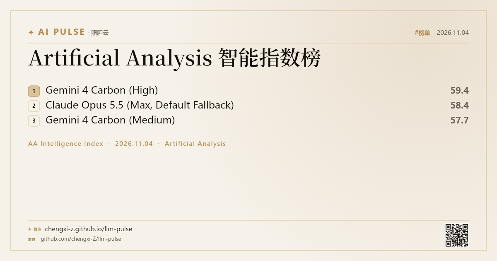
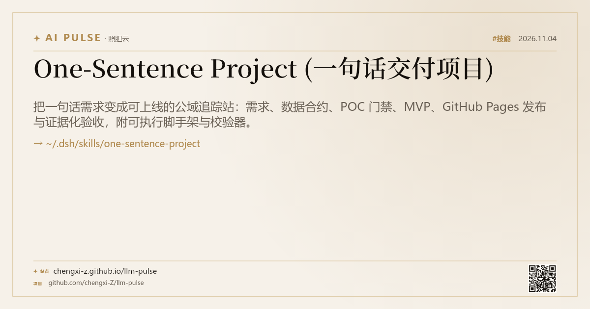
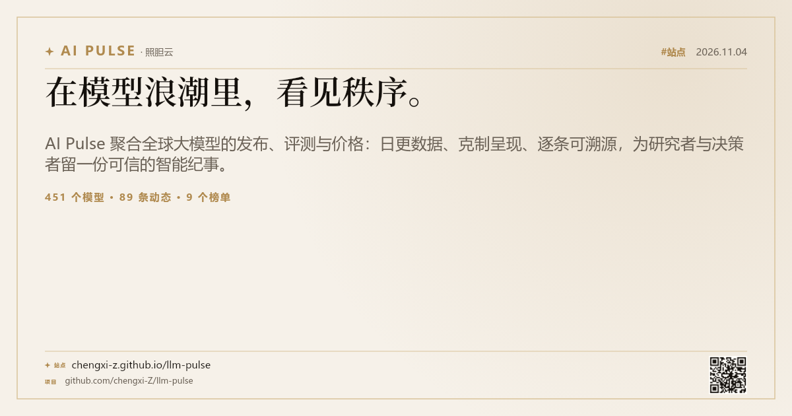
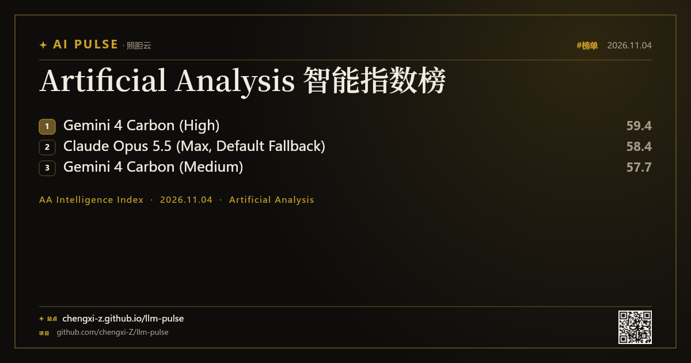
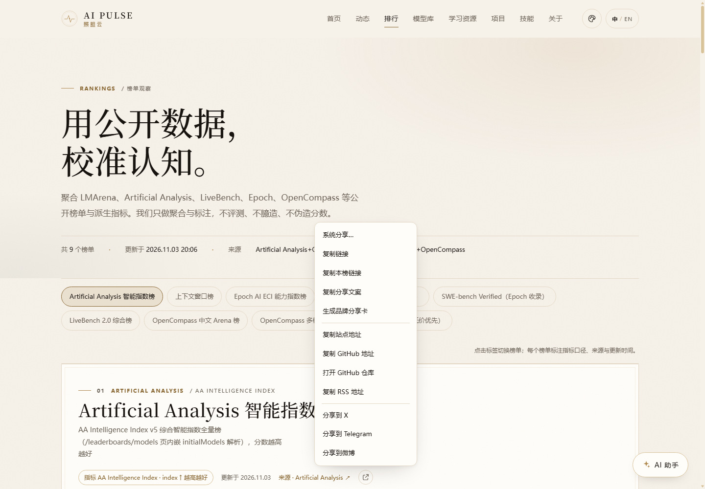
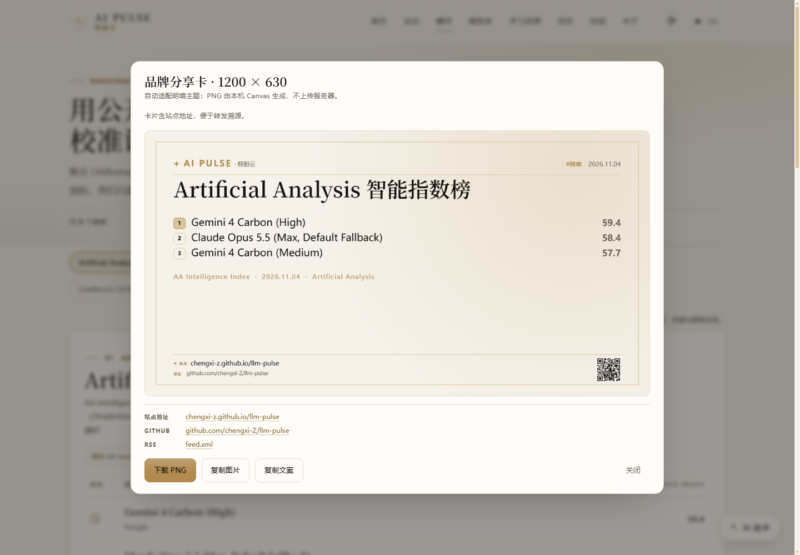
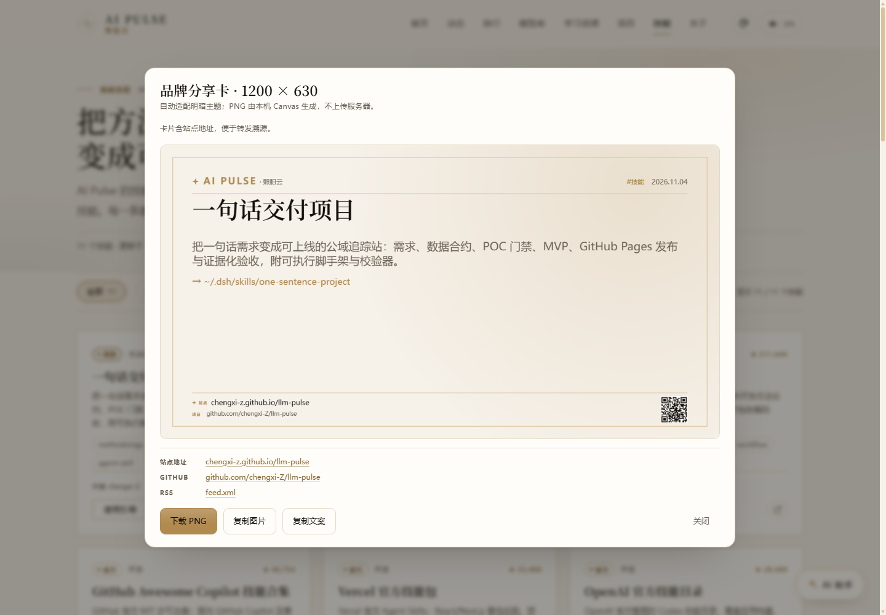

# 分发 Playbook（DISTRIBUTION · v1.2 R1）

> 负责人：ai-share ｜ 适用版本：v1.2.0+ ｜ 关联：`docs/V1.2-CONTRACT.md` §2、`docs/AI-SHARE.md`、`docs/SPEC.md` §6
> 目标：让每一张分享图/每一条分享文案都能**被看懂、被找到、被转发**——卡片自带站点与 GitHub 地址，文案自带溯源链接。

---

## 0. 一句话原则

1. **可溯源**：任何卡片/截图都必须能回到 `chengxi-z.github.io/llm-pulse` 或 `github.com/chengxi-Z/llm-pulse`（卡片极简 strip + 二维码 + 文案尾部三保险）。
2. **不造假**：只引用站点已收录数据；标注更新时间与来源；缺口写「暂不可用」。
3. **轻量克制**：一次只推一个主题（1 个榜单 / 1 个新模型 / 1 个技能），配 1 张卡 + 1 段短文案。
4. **可复用**：模板化文案 + 固定话题标签 + 固定节奏，降低每周分发成本。

**规范地址（所有渠道统一使用）**

| 用途 | 地址 |
|---|---|
| 站点 | `https://chengxi-z.github.io/llm-pulse/` |
| GitHub | `https://github.com/chengxi-Z/llm-pulse` |
| RSS | `https://chengxi-z.github.io/llm-pulse/feed.xml` |
| JSON Feed | `https://chengxi-z.github.io/llm-pulse/feed.json` |
| 榜单深链 | `https://chengxi-z.github.io/llm-pulse/rankings.html#board-<board-id>` |
| 技能深链 | `https://chengxi-z.github.io/llm-pulse/skills.html#<skill-id>` |

---

## 1. 分享卡 v1.4 解剖（Canvas 1200×630，极简分发 strip）

`share.js → drawShareCard()` 纯前端绘制，无外链图片（二维码为站内本地 PNG）、无 CORS/字体依赖（系统字体栈）。

| 区域 | 内容 | 规格 |
|---|---|---|
| 顶部 | 代码绘制星芒 logo + `AI PULSE` + 照胆云 + 类型徽标 + 本地化日期 | logo 为路径绘制，不依赖字体/图片 |
| 主标题 | 新闻标题 / 榜单名 / 技能名 / 站点标语 | 衬线 50–52px，自动换行（英文按词、中文按字、中英混排按 token），最多 2–3 行，超出省略 |
| 正文 | 新闻摘要 / 榜单 Top10（前三冠亚季徽章 + 4-10 紧凑列表）/ 技能一句话+安装目标 / 站点简介 | 前三 21px / 4-10 16px；内容区上限 y≈508 |
| 统计 | 站点真实统计（模型/动态/榜单/资源）或本榜指标+更新时间+来源 | 12–15px 金色，单行省略 |
| **分发 strip（v1.4 极简）** | 1px 金色分隔线 + 星芒小 logo + `站点/Site` 8px 标签 + **站点 URL 15px** + `项目/Repo` 8px 标签 + **GitHub 短地址 12.5px** + 右侧 **58px 二维码** | **strip 高 72px = 卡片 11.4%（≤12%）**；站点 URL 15px（≤16）ink 对比浅色 #14100C/#F6F1E9 ≈16:1、暗色 #F2ECE2/#0E0D0B ≈17:1；GitHub 12.5px muted 对比浅 ≈5:1、暗 ≈7:1；**不裁切**（文本终点 ≈x350，二维码起点 x1074）；二维码可选：加载失败自动跳过、不留空位 |
| 名次徽章（仅 board） | Top10：前三 36×30 徽章（#1 金底 / #2 香槟 / #3 描边）+ 冠军/亚军/季军 文字；4-10 名紧凑右栏；分数右对齐 | 内敛风，与榜单页 1/2/3 标记一致；不引入 emoji/外链 |
| 底部旧地址区 | 已移除（v1.4 用户反馈：分发信息不能喧宾夺主） | 旧 26px/23px 大字地址区与 96px 二维码被 strip 取代 |

**安全（P0）**：卡片全部文本使用 Canvas `fillText`（无 HTML 注入面）；不加载任何外链图片（二维码仅站内本地 `assets/img/qr-site.png`，失败跳过）；不读取/不写入用户数据；预览 canvas `aria-label` 使用 `share.card.previewAria + stripAria`。

**四种 kind**（`drawShareCard(canvas, payload, {kind})`，也自动从 `data-share-kind` 读取）：

| kind | 主标题 | 正文/统计 | 使用场景 |
|---|---|---|---|
| `news` | 新闻/动态标题 | 摘要 + 站点统计 | 新模型发布、定价变化、重要研究 |
| `board` | 榜单名 | **Top10：前三冠亚季徽章 + 4-10 紧凑列表 + 分数** + 指标 + 更新时间 + 来源 | 榜单周报、名次变动 |
| `skill` | 技能名（中英） | 一句话价值 + 安装目标 `~/.dsh/skills/...` | 技能推荐、Agent Playbook |
| `site` | 站点标语「看见秩序」 | 站点简介 + 真实统计 | 品牌/项目介绍、README 配图 |

**v1.4 验收口径（B7）**

- [x] strip 高度 72/630 = **11.43% ≤ 12%**；与主内容 1px 金色线分隔（`DISTRIBUTION_STRIP` 常量 + `tests/share.test.mjs` 断言）
- [x] 站点 URL 15px（≤16px）、GitHub 短地址 12.5px；二维码 58px ∈ [56,64]
- [x] 对比度：站点 ink ≈16:1 / GitHub muted ≈5:1（浅色）；暗色 ≥7:1；无裁切
- [x] 明暗两版 + 中英标签（`站点/Site`、`项目/Repo`）；四类 kind 一致
- [x] 榜单卡 Top10：前三冠亚季徽章 + 4-10 紧凑，分数列保留
- [x] 分享文案仍必含站点 URL + GitHub 地址
- [x] 安全：仅 `fillText`、无外链图片、二维码失败跳过、无用户数据

**明暗与语言**：`prefers-color-scheme` 自动切换两套配色；zh/en 由 `i18n.js` 当前语言决定（日期 zh `2026.11.04` / en `Nov 4, 2026`）。

**已生成的卡图（docs/screenshots/，真实 Canvas 输出，v1.4 极简 strip）**


> `share-card-v2-board*.png` 为 v1.4 Top3 历史截图；v1.5 起榜单卡为 Top10（前三冠亚季 + 4-10 紧凑），实现见 `site/assets/js/share-board.js`。









**浏览器内真实页面证据（Lead CDP 截图）**







---

## 2. 榜单分享（专项）

### 2.1 入口

- `rankings.html` 每个榜单面板右上角有「分享本榜 / Share this leaderboard」按钮（site-mvp 渲染，class `share-btn`）。
- 点击 → 分享菜单；菜单含 **复制本榜链接**（深链 `#board-<id>`）+ 复制站点/GitHub/RSS + X/Telegram/微博 + 生成品牌分享卡。

### 2.2 payload 契约（页面 ↔ share.js）

```html
<button type="button" data-share
  data-share-kind="board" data-share-type="board"
  data-share-board="artificial-analysis-intelligence"
  data-share-title="Artificial Analysis 智能指数榜"
  data-share-desc="Top3: 1. Gemini 4 Carbon 59.4 · 2. Claude Opus 5.5 58.4 · 3. ... · AA Intelligence Index · 更新于 2026.11.03 · 来源 Artificial Analysis"
  data-share-url="https://chengxi-z.github.io/llm-pulse/rankings.html#board-artificial-analysis-intelligence"
  data-share-stats="AA Intelligence Index · Artificial Analysis">分享本榜</button>
```

- `share.js` 优先用 `data-share-board` id + 站点 `window.__AIPULSE_DATA__` 解析**真实 Top3/指标/更新时间/来源**；解析不到时回退 `data-share-desc` 文本。
- 也支持程序化：`window.__AIPULSE_SHARE__.openMenu(anchor, {kind:'board', board:{...}})` 或 `openCard(payload)`。
- 深链格式 `#board-<id>`；复制本榜链接即复制 `data-share-url`（绝对地址 + hash），打开后自动定位榜单（site-mvp 负责 hash 切 tab，兼容旧 `#<id>`）。

### 2.3 推荐发布节奏

每周一发布「本周榜单速览」：1 张榜单卡 + 1 条短文案 + 深链；榜单 Top3 发生变化时做「变动提醒」。

---

## 3. 分享菜单能力（所有 `data-share` 元素通用）

| 菜单项 | 行为 | 文案/地址 |
|---|---|---|
| 系统分享…（移动端支持时） | `navigator.share` | 标题 + 站点地址 |
| 复制链接 | 复制 payload.url（榜单卡为本榜深链） | toast「链接已复制」 |
| 复制本榜链接（仅 board） | 复制 `#board-<id>` 深链 | 「本榜链接已复制」 |
| 复制分享文案 | 复制完整文案（标题/摘要/统计 + 站点 + GitHub） | 见 §4 |
| 生成品牌分享卡 | 打开 1200×630 预览弹窗（下载 PNG / 复制图片 / 复制文案） | 弹窗画布为极简 strip；下方另附可点击的站点/GitHub/RSS 地址行 |
| 复制站点地址 | `SITE_URL` | 「站点地址已复制」 |
| 复制 GitHub 地址 | `GITHUB_URL` | 「GitHub 地址已复制」 |
| 打开 GitHub 仓库 | 新窗口打开仓库 | — |
| 复制 RSS 地址 | `RSS_URL` | 「RSS 地址已复制」 |
| 分享到 X / Telegram / 微博 | 意图链接，文案均含站点 + GitHub 地址 | 见 §4 |

**硬约束**：复制文案与社交 intent **必须**同时包含站点 URL 与 GitHub 地址（长标题会截断到 90 字符，地址在末尾完整保留）。

---

## 4. 社交文案模板

> 通用结构：**钩子（1 句）+ 1–2 个关键数字/结论 + 站点地址 + GitHub 地址 + 话题标签**。
> 所有模板中的地址保持完整；中文渠道可省略 `https://` 前缀的展示变体，但复制/意图里用完整地址。

### 4.1 X / Twitter（英文，≤280 字符）

```text
AI Pulse tracks the LLM world in one place: 451 models, 89 news items, 9 public leaderboards — refreshed daily.

Top of the AA Intelligence Index this week: Gemini 4 Carbon (59.4), Claude Opus 5.5 (58.4).

https://chengxi-z.github.io/llm-pulse/
GitHub: https://github.com/chengxi-Z/llm-pulse
#LLM #AI #OpenSource
```

### 4.2 微博（中文）

```text
【本周 AI 模型榜单】AA 智能指数 Top3 出炉：Gemini 4 Carbon 59.4 / Claude Opus 5.5 58.4 / Gemini 4 Carbon (Medium) 57.7。
整合模型库、公开榜单、动态与学习资源，每日自动更新，全部标注来源。
站点：https://chengxi-z.github.io/llm-pulse/
GitHub：https://github.com/chengxi-Z/llm-pulse
#大模型# #AI# #开源项目#
```

### 4.3 即刻（中文，口语化）

```text
做了一个只做「可溯源」的大模型追踪站：模型库 / 公开榜单 / 厂商动态 / 学习资源都在一页，数据每天自动刷新，每条都能点回来源。
今天更新了 AA 智能指数榜，顺手做了张分享卡👇
https://chengxi-z.github.io/llm-pulse/
GitHub：https://github.com/chengxi-Z/llm-pulse
```

### 4.4 小红书（中文，标题 + 正文 + 标签）

```text
标题：每天 3 分钟，看懂大模型世界发生了什么

正文：
整理了一个轻量的大模型情报站，适合研究/选型/写周报：
· 451 个模型的价格与上下文，一处对比
· 9 个公开榜单（AA/LMArena/LiveBench/Epoch…），标注来源和更新时间
· 每天的发布与降价动态、精选学习资源
· 内置 AI 助手（可离线查站内数据），分享卡自带地址，转发不迷路
站点：chengxi-z.github.io/llm-pulse
GitHub：github.com/chengxi-Z/llm-pulse

标签：#大模型 #AI工具 #效率 #开源项目 #学习资源
```

### 4.5 Telegram（群/频道，中英均可）

```text
📊 AI Pulse · Weekly board update
AA Intelligence Index Top3:
1. Gemini 4 Carbon — 59.4
2. Claude Opus 5.5 — 58.4
3. Gemini 4 Carbon (Medium) — 57.7

🌐 https://chengxi-z.github.io/llm-pulse/
⭐ https://github.com/chengxi-Z/llm-pulse
RSS: https://chengxi-z.github.io/llm-pulse/feed.xml
```

### 4.6 朋友圈（中文，短，配卡图）

```text
每周一张榜：AA 智能指数 Top3 更新。
模型/榜单/动态/资源都在一个轻量站点里，数据每日刷新、逐条可溯源。
https://chengxi-z.github.io/llm-pulse/
GitHub：https://github.com/chengxi-Z/llm-pulse
```

### 4.7 技能推荐（配合 `data-share-kind="skill"` 卡片）

```text
【技能推荐】One-Sentence Project：把一句话需求变成可上线的公域数据站（需求 → 数据合约 → POC → MVP → Release）。
安装：复制到 ~/.dsh/skills/ 即可被 Agent 调用。
站点：https://chengxi-z.github.io/llm-pulse/skills.html#one-sentence-project
GitHub：https://github.com/chengxi-Z/llm-pulse
```

**话题标签池（按渠道取 2–4 个）**
- 中文：`#大模型#` `#AI#` `#开源项目#` `#LLM#` `#AI工具#` `#数据可视化#`
- English: `#LLM` `#AI` `#OpenSource` `#AIEngineering` `#LLMLeaderboard`

---

## 5. 渠道清单与节奏

### 5.1 渠道矩阵

| 渠道 | 内容形态 | 频率 | 备注 |
|---|---|---|---|
| **GitHub 仓库** | README（含卡片/截图/3 步本地运行）、topics `llm` `ai` `leaderboard` `static-site` `github-pages`、Release notes、About 链接站点 | 每次版本 | 最稳定的长期入口；README 顶部放站点与 feed |
| **RSS / JSON Feed** | 订阅源（`feed.xml` / `feed.json`） | 每日自动 | 供 RSS 阅读器、自动化转发、群机器人 |
| **V2EX**（分享创造/程序员节点） | 图文帖：项目介绍 + 卡图 + GitHub 链接 | 每版本 1 次 | 标题聚焦「轻量/纯静态/可溯源」 |
| **Hacker News**（Show HN） | 英文 Show HN：`Show HN: AI Pulse – a static, source-traceable LLM tracker` | 大版本 1 次 | 配英文卡图与 README.en |
| **Reddit**（r/LocalLLaMA、r/MachineLearning 需遵守版规） | 英文短帖 + 卡图 + GitHub | 大版本 1 次 | 避免纯推广，附方法/数据源说明 |
| **即刻 / 知乎** | 中文短文/回答（「有哪些好用的 AI 资讯站」类问题） | 每两周 | 口语化、讲取舍与方法 |
| **微信公众号 / 小红书** | 图文：本周榜单 + 卡片 + 学习资源 | 每周 | 卡片自带地址，图片可独立传播 |
| **微信群 / 飞书群 / Telegram 频道** | 卡片 + 1 段文案 + RSS 订阅链接 | 每周 | 可选 webhook 自动推送（见 AI-SHARE.md §3.5） |
| **X / 微博** | 单卡 + 短文案 + 深链 | 每周 1–2 次 | 用 intent 分享按钮一键生成 |

### 5.2 推荐周节奏

| 时间 | 动作 | 产物 |
|---|---|---|
| 周一 | 生成「本周榜单/新模型」卡，站点/GitHub 发首发 | 1 张卡 + 1 条长文案 |
| 周二 | RSS/群机器人广播；X/微博短文案 | 自动推送 |
| 周三 | 投稿/发帖（V2EX、即刻、知乎轮换） | 1 个渠道 |
| 周五 | 技能/学习资源推荐卡 | skill 卡 |
| 每版本 | GitHub Release + README 更新 + HN/Reddit（英文） | Release + Show HN |
| 每月 | 复盘渠道数据（GitHub Insights / 反馈），调整主题 | 月度小结 |

---

## 6. SEO / OG 检查清单

每个页面（8 页 + skills）发布前检查：

- [ ] `<title>` 与 `<meta name="description">` 已本地化（i18n `PAGE_META`，zh/en 双语）
- [ ] `og:title` / `og:description` / `twitter:title` / `twitter:description` 同步
- [ ] `og:image` = 1200×630（`site/assets/img/og-cover.png`），`og:url` = canonical 绝对地址
- [ ] `canonical` 指向 `https://chengxi-z.github.io/llm-pulse/<page>`
- [ ] `lang` / `data-lang` 正确（i18n.js 设置）
- [ ] 分享卡/站内链接使用绝对地址（`SITE_URL` 常量或 `new URL(..., document.baseURI)`）
- [ ] 站点可被索引（无 `noindex` 误加）；`robots.txt` 允许抓取
- [ ] 新页面加入导航与 sitemap/内部链接（如站点有 sitemap）
- [ ] 链接抽检：分享卡、菜单、intent 里的站点/GitHub/RSS/深链均 200（本地 `node scripts/serve.mjs` + 线上复检）

命令行快速检查（线上）：

```bash
# 站点可达 + OG 标签（用 Node fetch，避免本机 curl TLS 问题）
node -e "fetch('https://chengxi-z.github.io/llm-pulse/').then(r=>r.text()).then(t=>{for(const m of t.matchAll(/<meta[^>]+(og:|twitter:)[^>]+>/g))console.log(m[0])})"
```

---

## 7. 二维码 / 短链 / UTM

- **二维码资产**：`site/assets/img/qr-site.png`（站点，深墨 #14100C 于米白 #FFFDF9，纠错 M，512×512）、`qr-repo.png`（GitHub 仓库）。
- **卡片内**：站点二维码 58px 绘制在右下 strip 内（明暗主题共用同一张本地 PNG，含米白底保证扫描），站点/GitHub 地址以 15px/12.5px 文本同排展示。
- **线下/海报/演示**：幻灯片、海报、README 首图旁放 `qr-site.png`；代码仓库文档放 `qr-repo.png`；印刷最小尺寸建议 ≥2cm。
- **短链建议**（可选，不强制）：统一用 GitHub Pages 原地址最可信；若渠道限长/后台统计需要，可用自有域名 301 或 GitHub 仓库 About 的 Website 字段，避免频繁更换短链导致失效。
- **UTM（可选）**：由于站点无埋点，UTM 仅用于渠道侧统计（如 GitHub/社交平台链接点击）。示例：
  `https://chengxi-z.github.io/llm-pulse/?utm_source=x&utm_medium=social&utm_campaign=weekly-board`
  > 注意：分享卡/复制文案默认不带 UTM（保持短而干净）；手动发帖时按渠道追加。
- 二维码生成原则：离线生成、深墨浅底、纠错 M、不要拉伸；更新站点域名时同步重生成。

---

## 8. 数据溯源与可信话术

**站内已具备的溯源要素**：每条动态/榜单标注 `sourceName` + `sourceUrl` + `updatedAt`；模型价格来自公开 API 目录；空态明确「暂不可用」；页脚与关于页说明方法与免责声明。

**可复用的可信表述（中/英）**

- 中文：
  - 「数据来自公开 API 与官方博客，逐条标注来源与更新时间；抓取失败的来源会显示降级状态，不补假数据。」
  - 「排行榜是公开榜单的聚合，不同榜单口径不同，不做横向混算。」
  - 「本站为纯静态站，数据由 GitHub Actions 定时刷新；AI 助手默认离线，配置密钥后才走你自己的模型端点。」
- English:
  - "Every item links back to its public source and timestamp; degraded sources are flagged, never padded with fake data."
  - "Leaderboards are aggregated from public boards with their own metrics — no cross-board mixing."
  - "Static site refreshed by GitHub Actions; the built-in assistant works offline, BYOK only."

**面对质疑的标准回复**
1. 数字不一致 → 给出页面「数据更新时间 + 来源链接」，说明数据快照时间点。
2. 榜单排名疑问 → 指引榜单页「口径说明 + 原始来源」，并说明不同榜单不可直接比较。
3. 数据过时 → 提示 Actions 刷新机制 + RSS 订阅；说明可手动触发 workflow。
4. 隐私疑虑 → 说明无登录/无埋点/无后端，BYOK 密钥只存浏览器 localStorage。

---

## 9. 每周分发 Checklist（可复制）

```markdown
## 本周分发 Checklist（W__）
- [ ] 数据已刷新（站点时间戳 ≤24h；meta.sources 无异常降级）
- [ ] 选主题：榜单变化 / 新模型 / 技能推荐（三选一）
- [ ] 生成分享卡（对应 kind：board / news / skill），检查：logo、标题、Top3/摘要、统计、站点地址、GitHub 地址、二维码、日期
- [ ] 复制文案（必须含站点 URL + GitHub 地址）；按渠道套 §4 模板
- [ ] 站点 + GitHub 首发（Release/README 如版本更新）
- [ ] X / 微博 / 即刻 / 小红书 / 群 按 §5.2 节奏分发
- [ ] RSS/Telegram/飞书（可选 webhook）自动广播确认
- [ ] 检查深链：`rankings.html#board-<id>` / `skills.html#<id>` 可直达
- [ ] OG/SEO 抽查（title/desc/og:image/canonical）
- [ ] 记录反馈与渠道效果（GitHub stars、feed 订阅、评论问题）
- [ ] 下周主题预选
```

---

## 10. 效果观察（无埋点原则）

本站不采集用户数据、无第三方统计脚本。可用的**外部**观察口径：

- GitHub：stars / forks / Issues / Release 下载量、traffic（仓库 Insights，需权限）。
- RSS：订阅器侧统计不可见；用群机器人/频道转发量间接估算。
- 渠道：帖子浏览/点赞/评论数（平台侧数据）、问题类型（选型/价格/榜单口径）。
- 反馈闭环：Issue 表单（数据纠错/收录申请/技能提交）是最有价值的信号。

---

## 11. 快速参考

```js
// 浏览器控制台 / 其他脚本（站点已加载 share.js 时）
window.__AIPULSE_SHARE__.links
// { siteUrl, siteHost, githubUrl, githubHost, rssUrl }

// 生成并下载分享卡（自动读取当前页面/传入 payload）
await window.__AIPULSE_SHARE__.downloadCard({ kind:'board', title:'AA 智能指数榜', board:{...} });

// 复制完整分享文案（含站点 + GitHub 地址）
window.__AIPULSE_SHARE__.buildMessage({ kind:'news', title:'OpenAI 发布 GPT-6.1 Terra Pro' });

// 榜单：按 id 打开分享菜单（无需自己拼 payload）
window.__AIPULSE_SHARE__.openBoard(document.querySelector('.share-btn'), 'artificial-analysis-intelligence');
```

**相关文档**：`docs/AI-SHARE.md`（助手/Feed/webhook 技术细节）、`docs/SPEC.md` §6、`docs/V1.2-CONTRACT.md` §2。
